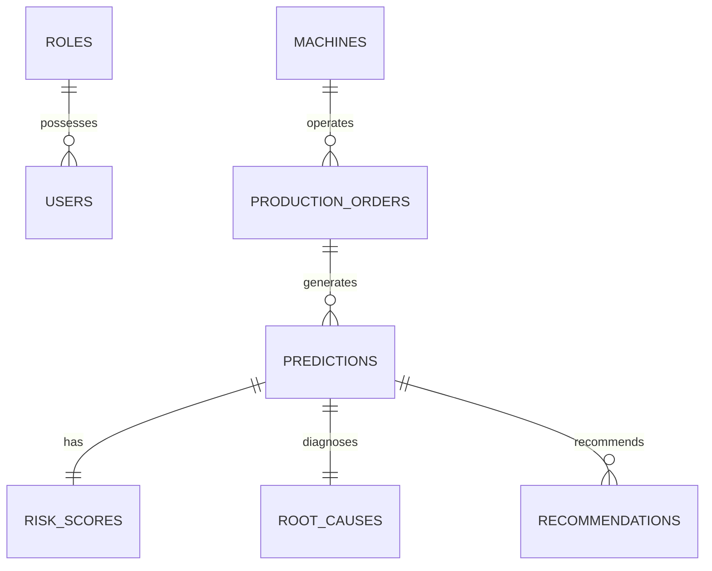

# Database Schema Documentation

The relational database uses SQLite with SQLAlchemy ORM.

## Relational Entity Relationship Diagram

## Table Specifications

### 1. `users`
- `id`: Integer Primary Key
- `email`: String Unique Indexed
- `hashed_password`: String (Salted PBKDF2)
- `full_name`: String
- `role_id`: Integer Foreign Key -> `roles.id`
- `is_active`: Boolean

### 2. `roles`
- `id`: Integer Primary Key
- `name`: String Unique (Admin, Production Manager, Analyst)
- `description`: String

### 3. `production_orders`
- `id`: Integer Primary Key
- `order_id`: String Unique Indexed (e.g. ORD-1001)
- `product_family`: String
- `order_quantity`: Integer
- `planned_duration_days`: Float
- `machine_capacity_utilization`: Float
- `machine_downtime_hours`: Float
- `material_availability_pct`: Float
- `workforce_availability_pct`: Float
- `status`: String (Scheduled, In Progress, Completed, Delayed)

### 4. `predictions`
- `id`: Integer Primary Key
- `order_db_id`: Integer Foreign Key -> `production_orders.id`
- `delay_probability`: Float (0-100%)
- `is_delayed_predicted`: Boolean
- `expected_delay_days`: Float

### 5. `risk_scores`
- `id`: Integer Primary Key
- `prediction_id`: Integer Foreign Key -> `predictions.id`
- `risk_score`: Float (0-100)
- `risk_category`: String (LOW, MEDIUM, HIGH, CRITICAL)
- `breakdown_json`: Text

### 6. `root_causes`
- `id`: Integer Primary Key
- `prediction_id`: Integer Foreign Key -> `predictions.id`
- `primary_cause`: String
- `primary_cause_pct`: Float
- `human_explanation`: Text

### 7. `recommendations`
- `id`: Integer Primary Key
- `prediction_id`: Integer Foreign Key -> `predictions.id`
- `action_name`: String
- `expected_delay_days`: Float
- `improvement_days`: Float
- `is_recommended`: Boolean
