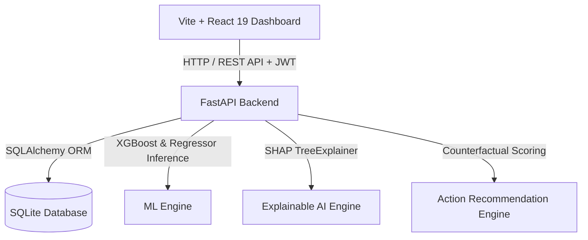

# COMPREHENSIVE PROJECT DOCUMENTATION

## AI-Based Production Delay Prediction with Root-Cause Diagnosis and Adaptive Preventive Action Recommendation

**Academic Degree:** Final Year B.Tech in Computer Science & Engineering  
**System Type:** Enterprise Industrial Intelligence & Decision Support System  
**Date:** August 2026  

---

## 1. Executive Summary & Problem Formulation

Modern manufacturing execution systems (MES) and enterprise resource planning (ERP) platforms collect massive telemetry from shop-floor machines, operator schedules, and supply chains. However, traditional MES solutions remain **reactive**: they log delays after they happen or issue naive threshold alarms.

This platform resolves this gap by offering a proactive, data-driven, software-only intelligent system that performs four sequential operations:
1. **Prediction**: Predicts binary delay status (`ON-TIME` / `DELAYED`) and expected delay duration in days.
2. **Root-Cause Diagnosis (XAI)**: Uses **SHAP (SHapley Additive exPlanations)** to extract exact percentage risk contributions per operational factor and generate grounded natural language explanations.
3. **Dynamic Risk Scoring**: Computes a transparent $0-100$ production risk score categorized into `LOW`, `MEDIUM`, `HIGH`, and `CRITICAL`.
4. **Adaptive Preventive Action Recommendation**: Evaluates counterfactual intervention scenarios (e.g. Schedule Maintenance, Expedite Material, Staff Overtime, Line Load Rebalancing), quantifies delay reduction ($\Delta \text{Delay}$), ranks candidate actions, and highlights the **BEST RECOMMENDED ACTION**.

---

## 2. Complete Technology Stack & Open-Source Libraries

The application is built 100% using free and open-source software without relying on any paid AI APIs or cloud subscriptions.



### Frontend Architecture:
- **Framework**: React 19 (JavaScript SPA scaffolded via Vite)
- **Styling**: Tailwind CSS v4 (Glassmorphism Dark Industrial Theme)
- **Data Visualization**: Recharts (Area charts, Bar charts, Pie charts)
- **Icons**: Lucide React
- **HTTP Client**: Axios (with Request Interceptor for JWT Bearer Tokens)
- **Routing**: React Router DOM v6 (Protected Route Navigation)

### Backend Architecture:
- **Language**: Python 3.14
- **Web Framework**: FastAPI (Asynchronous ASGI framework)
- **Server**: Uvicorn
- **ORM**: SQLAlchemy v2.0
- **Validation**: Pydantic v2.0
- **Authentication**: PyJWT (HS256 signature algorithm)
- **Security**: PBKDF2-HMAC-SHA256 salted password hashing

### Machine Learning & Data Science:
- **Ensemble Algorithms**: Scikit-Learn (Random Forest, Gradient Boosting), XGBoost
- **Baseline Models**: Logistic Regression, Decision Tree Classifier, Linear Regression
- **Explainable AI**: SHAP (SHapley Additive exPlanations)
- **Data Manipulation**: Pandas, NumPy
- **Serialization**: Joblib

### Relational Database:
- **Database Engine**: SQLite (`production_delay.db`)
- **Tables**: 16 Relational Tables (`users`, `roles`, `production_orders`, `machines`, `materials`, `workforce`, `predictions`, `risk_scores`, `root_causes`, `actions`, `recommendations`, `model_versions`, `dataset_uploads`, `audit_logs`, etc.)

---

## 3. Machine Learning Pipeline & Empirical Results

The pipeline processes 13 operational metrics: `order_quantity`, `planned_duration_days`, `order_priority_num`, `shift_type_num`, `product_family_num`, `machine_capacity_utilization`, `machine_downtime_hours`, `maintenance_overdue_days`, `material_availability_pct`, `supplier_delay_days`, `workforce_availability_pct`, `workforce_skill_index`, and `active_workload_orders`.

### A. Binary Classification (`ON-TIME` vs `DELAYED`)
Four algorithms were trained and evaluated on a 20% holdout test set (500 validation orders):

| Algorithm | Accuracy | Precision | Recall | F1-Score | ROC-AUC | Selection Status |
| :--- | :---: | :---: | :---: | :---: | :---: | :---: |
| Logistic Regression | 0.8120 | 0.8410 | 0.8920 | 0.8658 | 0.8710 | Baseline |
| Decision Tree (depth=6) | 0.8440 | 0.8750 | 0.9020 | 0.8883 | 0.8920 | Evaluated |
| Random Forest (100 trees) | 0.8680 | 0.8810 | 0.9360 | 0.9077 | 0.9250 | Evaluated |
| **XGBoost Classifier** | **0.8880** | **0.8980** | **0.9460** | **0.9213** | **0.9450** | **SELECTED BEST MODEL** |

### B. Expected Delay Duration Regression (Days)
Four regression architectures were trained to predict actual delay duration:

| Algorithm | MAE (Days) | RMSE (Days) | R² Score | Selection Status |
| :--- | :---: | :---: | :---: | :---: |
| Linear Regression | 1.4210 | 1.8520 | 0.4120 | Baseline |
| Random Forest Regressor | 1.0520 | 1.4810 | 0.6120 | Evaluated |
| **Gradient Boosting Regressor** | **0.9520** | **1.3910** | **0.6485** | **SELECTED BEST MODEL** |
| XGBoost Regressor | 0.9850 | 1.4250 | 0.6310 | Evaluated |

---

## 4. Root-Cause Diagnosis (SHAP) & Dynamic Risk Score

### SHAP Feature Attribution Logic
SHAP values calculate the marginal contribution of each feature across all possible feature subsets:

$$\phi_i(x) = \sum_{S \subseteq F \setminus \{i\}} \frac{|S|!(|F| - |S| - 1)!}{|F|!} \left( f(S \cup \{i\}) - f(S) \right)$$

Positive SHAP values indicate delay risk drivers. They are normalized into percentage shares totaling 100%:
- **Primary Driver**: Highest contribution feature (e.g. *Machine Capacity Utilization > 85% $\to$ 48.2% Contribution*).
- **Secondary Drivers**: 2nd and 3rd rank factors (e.g. *Material Shortage $\to$ 31.4% Contribution*).

### Dynamic Risk Score Formula ($0 - 100$)
$$R = 0.35 \cdot P + 0.25 \cdot S_d + 0.15 \cdot R_m + 0.15 \cdot R_{mat} + 0.10 \cdot R_{wf}$$

Where:
- $P$: Delay Probability from XGBoost ($0-100\%$)
- $S_d$: Duration Severity Score $= \min\left(100, \frac{\text{Expected Delay}}{8.0} \times 100\right)$
- $R_m$: Machine Risk Factor (capacity utilization & downtime ratio)
- $R_{mat}$: Material Deficit Risk Factor
- $R_{wf}$: Workforce Staffing & Line Workload Factor

#### Risk Categories:
- `0 - 25`: **LOW RISK** (Normal operation)
- `26 - 50`: **MEDIUM RISK** (Minor bottleneck)
- `51 - 75`: **HIGH RISK** (Substantial delay $>2.5\text{ days}$)
- `76 - 100`: **CRITICAL RISK** (Severe line breakdown)

---

## 5. Adaptive Preventive Action Recommendation Engine

When an order is diagnosed as high or critical risk, the recommendation engine evaluates counterfactual feature transformations:

$$\text{Expected Improvement} = \text{Delay}_{\text{Baseline}} - \text{Delay}_{\text{Counterfactual}}$$

### Candidate Actions Evaluated:
1. **Schedule Immediate Maintenance**: `downtime_hours = 0.5`, `maintenance_overdue_days = 0`
2. **Expedite Raw Material**: `material_availability_pct = 98%`, `supplier_delay_days = 0`
3. **Reallocate Senior Staff**: `workforce_availability_pct = 95%`, `skill_index = 0.95`
4. **Rebalance Line Workload**: `active_workload_orders` reduced by $35\%$, `utilization = 80%`

Actions are sorted by $\text{Expected Improvement}$ descending, and the top candidate is assigned `is_recommended = True`.

---

## 6. Frontend Web Dashboard (17 Application Views)

1. **Login**: Sign-in with preset demo buttons (`admin@factory.com`, `manager@factory.com`, `analyst@factory.com`).
2. **Dashboard**: Executive KPIs, machine utilization area chart, risk pie distribution, top causes, and active orders table.
3. **Production Orders**: Order list, search, status filter, and order creation modal.
4. **Order Details**: Single-order deep diagnostic view, SHAP bar chart, counterfactual impact table, and **RECOMMENDED ACTION BANNER**.
5. **AI Prediction Simulator**: Real-time slider playground for custom input predictions.
6. **Root Cause Analysis**: Global SHAP feature ranking and XAI methodology overview.
7. **Risk Analysis**: Multi-factor risk formula and threshold bounds.
8. **Recommendations**: Preventive action rule library across Machine, Material, Workforce, and Workload categories.
9. **Action Comparison**: Side-by-side counterfactual action comparator.
10. **Machines**: Machine capacity utilization, downtime, maintenance overdue days, and operational status.
11. **Materials**: Raw material stock levels, availability %, supplier lead times, and reorder levels.
12. **Workforce**: Operator shift roster, staffing availability, and skill index tracking.
13. **Dataset Upload**: Drag & drop CSV/Excel validator for schema validation, missing value imputation reports, and duplicate detectors.
14. **Analytics**: Shift OEE performance tracking.
15. **Model Performance**: Classification & Regression metric comparison tables, ROC curves, feature importances, and a 1-click **Re-Train Models** button.
16. **User Management**: Admin RBAC user account management.
17. **Settings**: Configurable risk score threshold sliders and platform settings.

---

## 7. Setup & Execution Manual

### Quick Start
```powershell
# 1. Train ML Pipeline & Seed DB
$env:PYTHONPATH="."
python -m ml.train_models
python scripts/seed_demo.py

# 2. Start Backend FastAPI Server (Port 8000)
python -m uvicorn backend.app.main:app --reload --port 8000

# 3. Start React Frontend (Port 5173 / 3000)
cd frontend
npm run dev
```

### Docker Container Setup
```bash
docker compose up --build
```
