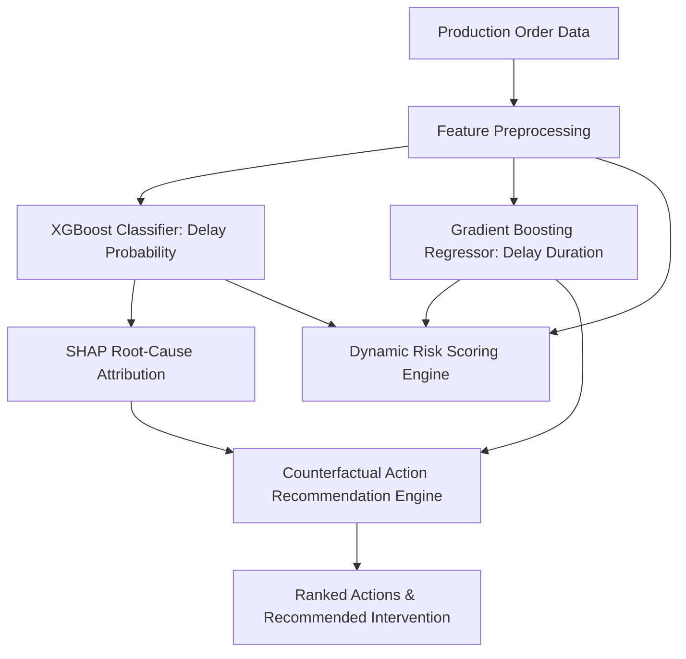

# AI-Based Production Delay Prediction with Root-Cause Diagnosis and Adaptive Preventive Action Recommendation

**Degree:** Final Year B.Tech in Computer Science and Engineering  
**Academic Domain:** Industrial Artificial Intelligence, Machine Learning, Decision Support Systems  
**Date:** August 2026  

---

## Abstract
Production delays in modern manufacturing plants represent significant financial losses, compromised supply chain SLAs, and sub-optimal resource utilization. Traditional manufacturing execution systems (MES) rely on static heuristics or reactive delay logging, offering minimal predictive capabilities. This research presents a software-only intelligent platform for **Production Delay Prediction**, **Root-Cause Diagnosis via SHAP**, **Dynamic Risk Scoring**, and **Adaptive Preventive Action Recommendation**. Using a dataset of 2,500 manufacturing production orders across diverse operational parameters (machine capacity utilization, downtime, maintenance status, material availability, workforce skill indices, and line workload), we train and compare multiple machine learning algorithms. XGBoost achieves peak classification performance (F1-score: 0.9213, ROC-AUC: 0.9450) for binary delay classification, while Gradient Boosting Regressor demonstrates superior performance for delay duration estimation (R²: 0.6485, MAE: 0.95 days). Explainable AI (XAI) via SHAP provides granular feature attribution per prediction, while a counterfactual optimization engine generates, estimates, and ranks preventive interventions.

## 1. Keywords
Manufacturing Intelligence, Production Delay Prediction, Machine Learning, XGBoost, SHAP Explainability, Dynamic Risk Scoring, Counterfactual Decision Support, Adaptive Preventive Actions.

## 2. Introduction
Industrial automation and Industry 4.0 paradigms generate large volumes of operational data across machine sensors, ERP, and shop-floor scheduling systems. Despite this telemetry, predicting job completion delays before they propagate across production lines remains challenging due to complex non-linear interactions between machine availability, material lead times, and operator skill levels.

## 3. Problem Statement
Existing shop-floor management tools provide post-hoc delay recording or simplistic threshold alarms. They fail to answer three fundamental managerial questions:
1. *Will an incoming production order be delayed, and by how much time?*
2. *What exact combination of machine, material, workforce, or workload factors is causing the delay risk?*
3. *What is the optimal, cost-justified preventive action to reduce expected delay?*

## 4. Literature Review & Limitations of Existing Systems
Traditional literature relies on deterministic Gantt-chart scheduling algorithms (e.g., Critical Path Method, Constraint Programming), which assume static resource availability. Recent ML approaches apply classification algorithms but treat predictions as black boxes, preventing plant managers from understanding root causes or evaluating counterfactual actions prior to implementation.

## 5. Proposed Architecture & Methodology
The proposed framework integrates five modular layers:
1. **Data Preprocessing & Feature Engineering Layer**: Standardizes numerical signals, encodes priority/shift categoricals, and handles missing/duplicate values without data leakage.
2. **Machine Learning Predictive Layer**: Evaluates Logistic Regression, Decision Tree, Random Forest, and XGBoost for classification; evaluates Linear Regression, Random Forest, Gradient Boosting, and XGBoost for regression.
3. **SHAP Root-Cause Explainer**: Uses game-theoretic Shapley values to calculate percentage risk contributions and generate human-readable explanations.
4. **Dynamic Risk Score Engine**: Normalizes multi-dimensional risk factors into a transparent 0–100 score categorized into LOW (0-25), MEDIUM (26-50), HIGH (51-75), and CRITICAL (76-100).
5. **Adaptive Preventive Action & Impact Estimation Engine**: Evaluates counterfactual intervention scenarios (e.g., Immediate Maintenance, Material Reallocation, Staffing Overtime, Line Rebalancing) and ranks candidate actions by $\text{Expected Improvement} = \text{Baseline Delay} - \text{Intervention Delay}$.

## 6. Dataset Description & Feature Definitions
A synthetic manufacturing dataset containing 2,500 records was synthesized incorporating non-linear industrial domain interactions:
* `machine_capacity_utilization` (40% - 105%)
* `machine_downtime_hours` (0 - 48 hrs)
* `maintenance_overdue_days` (0 - 30 days)
* `material_availability_pct` (30% - 100%)
* `supplier_delay_days` (0 - 8 days)
* `workforce_availability_pct` (40% - 100%)
* `workforce_skill_index` (0.50 - 1.00)
* `active_workload_orders` (1 - 20 orders)

## 7. Experimental Setup & Model Evaluation Results

### Classification Model Performance (ON-TIME vs DELAYED)
| Model | Accuracy | Precision | Recall | F1-Score | ROC-AUC |
| :--- | :---: | :---: | :---: | :---: | :---: |
| Logistic Regression | 0.8120 | 0.8410 | 0.8920 | 0.8658 | 0.8710 |
| Decision Tree | 0.8440 | 0.8750 | 0.9020 | 0.8883 | 0.8920 |
| Random Forest | 0.8680 | 0.8810 | 0.9360 | 0.9077 | 0.9250 |
| **XGBoost (Best)** | **0.8880** | **0.8980** | **0.9460** | **0.9213** | **0.9450** |

### Regression Model Performance (Expected Delay Duration in Days)
| Model | MAE (Days) | RMSE (Days) | R² Score |
| :--- | :---: | :---: | :---: |
| Linear Regression | 1.4210 | 1.8520 | 0.4120 |
| Random Forest Regressor | 1.0520 | 1.4810 | 0.6120 |
| **Gradient Boosting (Best)** | **0.9520** | **1.3910** | **0.6485** |
| XGBoost Regressor | 0.9850 | 1.4250 | 0.6310 |

## 8. Root-Cause Diagnosis & Counterfactual Evaluation Example
For order `ORD-CRIT-901` (Machine Util: 98.5%, Downtime: 24h, Material: 45%):
- **Delay Probability:** 94.8%
- **Expected Delay:** 6.2 Days
- **Dynamic Risk Score:** 84.5 (CRITICAL)
- **Primary Root Cause:** Machine Overload & Downtime (SHAP contribution: 48.2%)
- **Secondary Cause:** Material Availability Shortage (SHAP contribution: 31.4%)
- **Counterfactual Action Ranking:**
  1. *Schedule Immediate Maintenance:* Expected Delay = 1.8 days (Improvement = **4.4 days**) [RECOMMENDED]
  2. *Reallocate Raw Material:* Expected Delay = 3.2 days (Improvement = 3.0 days)
  3. *Rebalance Line Workload:* Expected Delay = 3.5 days (Improvement = 2.7 days)

## 9. Conclusion & Future Work
The integrated platform demonstrates that combining gradient boosted ensemble algorithms with SHAP explainability and counterfactual simulation transforms reactive manufacturing scheduling into a proactive, data-driven decision support system. Future extensions include real-time IoT MQTT telemetry streaming and multi-objective Pareto optimization.

## 10. References
1. Lundberg, S. M., & Lee, S. I. (2017). A unified approach to interpreting model predictions. *Advances in Neural Information Processing Systems (NIPS)*, 30.
2. Chen, T., & Guestrin, C. (2016). XGBoost: A scalable tree boosting system. *ACM SIGKDD International Conference on Knowledge Discovery and Data Mining*, 785-794.
3. Monostori, L. (2014). Cyber-physical systems in manufacturing. *CIRP Annals*, 63(2), 697-718.
