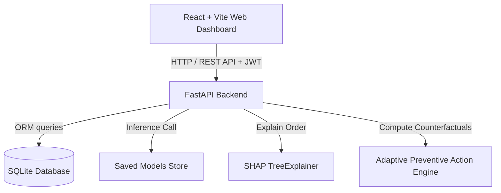

# System Architecture & Technical Specifications

## Architectural Overview
The platform uses a decoupled client-server architecture:

- **Frontend Application**: React 18, Vite, Tailwind CSS, Recharts, Lucide React, Axios, React Router v6.
- **Backend Application**: Python 3.14, FastAPI, Uvicorn, SQLAlchemy ORM, PyJWT, Pydantic v2.
- **ML Engine**: Scikit-Learn, XGBoost, SHAP, Pandas, NumPy, Joblib.
- **Database**: SQLite relational database (`production_delay.db`).

## Security & Authentication Layer
- **Token Mechanism**: Standard OAuth2 Password Bearer JSON Web Tokens (JWT) signed with HS256 algorithm.
- **Password Storage**: PBKDF2-HMAC-SHA256 salted password hashing.
- **Role-Based Access Control (RBAC)**:
  - `Admin`: Full permissions across orders, machines, materials, workforce, users, dataset upload, and retraining.
  - `Production Manager`: Can create/edit orders, view predictions, execute diagnostics, and evaluate recommendations.
  - `Analyst`: Access to dataset upload validation, model evaluation metrics, and retraining.
